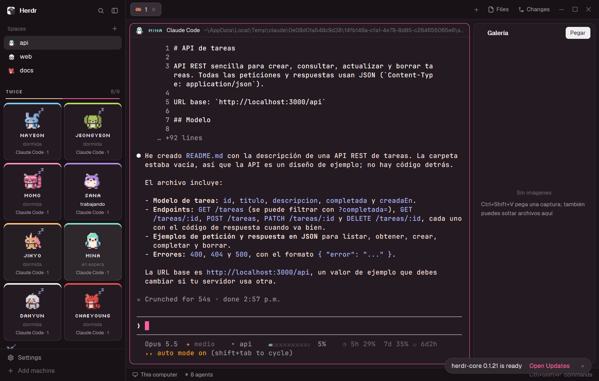

# herdr-twice

[English](README.md)

Un layout para [herdr](https://herdr.dev) en el que cada agente lleva una mascota pixel de TWICE que muestra
su estado, más una galería de imágenes para Claude Code y una statusline de Claude Code a juego.



- **twice-nine**: una mascota por agente (trabajando, te necesita, listo, en espera, dormida). Las libres
  duermen en la banca. `Alt+T` elige integrante; la elección se recuerda por espacio.
  - Una sesión que lanzó a otra dice «esperando a» ella mientras trabaja, y la hija dice con quién trabaja.
  - Los subagentes de Claude Code salen como coristas en la tarjeta de su sesión (`--subagentes`).
  - **El escenario**, un panel bajo la galería (`Alt+R`): cada estado tiene su sitio, y quien te necesita se lleva el foco.
- **spaces-twice**: la lista de espacios, con la mascota de su agente como avatar.
- **galeria**: `Ctrl+Shift+V` guarda una captura como `@imagenN`; escribe `@imagen3` en Claude Code para usarla. Una pequeña × en cada miniatura borra esa imagen.
- **nombre-agente**: los espacios sin nombre toman el título de su agente; `Ctrl+Shift+M` abre Claude en una carpeta.
- **statusline**: modelo, esfuerzo, rama, contexto y límites de uso en una línea.
- **Cursor CLI y Codex**: un lanzador mínimo y hooks para que sus agentes también tengan mascota.
- Temas `apricot-neon` (oscuro) y `apricot-cream` (claro).

## Instalar

Requisitos: herdr-app (ábrelo una vez), Node y git.

**Lo más fácil:** pega esto en un agente dentro de herdr (es la misma línea que da la [galería de herdr](https://herdr.dev/gallery/)):

```
Read ~/.config/herdr-app/AGENTS.md, then add this layout: https://github.com/JhonZBM/herdr-twice/tree/main
```

Sigue las reglas de herdr: copia sin pisar y pregunta antes de cambiar un atajo que ya uses.

**Con el script** (los mods quedan enlazados al clon, así `git pull` los actualiza):

```sh
git clone https://github.com/JhonZBM/herdr-twice
cd herdr-twice
node instalar.js --galeria --statusline --subagentes --cursor --codex
```

Clónalo donde quieras: nada depende de su ubicación. Se puede repetir: solo añade lo que falta y avisa (sin
pisar) si algo es distinto; `--forzar` lo pisa.

- `--galeria` añade la regla de `@imagenN` a `~/.claude/CLAUDE.md`.
- `--statusline` enlaza `~/.claude/statusline` al clon y pone `statusLine` en `~/.claude/settings.json`.
- `--subagentes` enlaza `~/.claude/subagentes` al clon y añade sus hooks (`SubagentStart`, `SubagentStop`, `Stop`,
  `SessionStart`, `SessionEnd`, todos `async`) a `~/.claude/settings.json`, detrás de los que ya tengas.
- `--cursor` añade los hooks a `~/.cursor/hooks.json` y una entrada **Cursor (TWICE)** al menú `+` de herdr.
- `--codex` añade los hooks a `~/.codex/hooks.json` y una entrada **Codex (TWICE)** al menú `+`. Codex no ejecuta hooks
  nuevos hasta que los revisas: ábrelo, escribe `/hooks` y acéptalos.

El arte de los mods (sus `.svg`) se copia a `~/.config/herdr-app/herdr-twice/`: herdr solo dibuja imágenes que estén
de verdad en su carpeta y no las ve a través del enlace del mod.

Reinicia herdr para cargar la fuente pixel. Para actualizar: `git pull` y otra vez `node instalar.js` (temas,
layout y arte son copias).

## Solo un mod

Cada mod funciona por su cuenta y lleva en su carpeta su `RECIPE.md`, su `keys.json` y su captura:
[twice-nine](mods/twice-nine), [galeria](mods/galeria), [spaces-twice](mods/spaces-twice),
[nombre-agente](mods/nombre-agente).

- Pídeselo a tu agente en herdr: *«añade este mod de herdr: https://github.com/JhonZBM/herdr-twice/tree/main/mods/galeria»*.
- O con el script: `node instalar.js --solo galeria` (varios: `--solo galeria,twice-nine`). Instala esos mods y
  sus atajos sin tocar tu layout ni tus temas; luego pídele a tu agente que los coloque según su RECIPE.md.

## Atajos

| Tecla | Acción |
|---|---|
| `Ctrl+Shift+V` | Pegar captura o imagen en la galería |
| `Alt+G` | Vista previa de la última imagen (`←` `→` pasar, `Enter` insertar `@imagenN`, `Esc` cerrar) |
| `Alt+T` | Elegir integrante del agente enfocado |
| `Alt+Shift+T` | Siguiente integrante libre |
| `Alt+R` | Mostrar u ocultar el escenario |
| `Ctrl+Shift+M` | Abrir un espacio con Claude en una carpeta |
| `Ctrl+Shift+L` | Cambiar de layout (salida si `twice` falla) |

## Statusline

```
Opus 5.5  ✦ medio    ▸ repo    main  ·  3 cambios    ⇡ 1    ▰▰▰▰▱▱▱▱▱▱  42%    ◷ 5h 30%  7d 65% ↻ 2d4h
```

- Esfuerzo: ✧ bajo · ✦ medio · ✷ alto · ✸ xalto · ✹ máximo.
- Rama: ✓ limpia o `· N cambios`; `⇡` commits sin subir, `⇣` por bajar.
- Contexto: verde < 50 %, amarillo < 80 %, rojo después.
- Límites de uso (`◷`): 5 h y semanal, cada uno con sus umbrales y `↻` hasta el reinicio.
- Iconos, colores, umbrales y espaciado en `statusline/iconos.json` (sin tocar código).

## Notas

- Pegar en la galería es solo Windows (PowerShell); soltar archivos funciona en todos.
- Las mascotas siguen a los agentes que informan su estado a herdr (Claude Code lo hace). Cursor CLI y Codex no lo hacen solos:
  ábrelos desde **Cursor (TWICE)** / **Codex (TWICE)** en el menú `+` (o `node agentes/lanzador.js cursor|codex`). Sus hooks
  corren fuera del terminal, así que avisan a ese lanzador, que le pasa el estado a herdr.
  - Cursor no tiene hook para cuando pide permiso, así que «te necesita» no sale.
  - Codex sí muestra «te necesita» al pedir permiso; se abre siempre con `--no-daemon`, como exige herdr.
  - Gemini CLI queda fuera: Google lo reemplazó por Antigravity CLI.
- «Esperando a» necesita que herdr sepa quién lanzó a quién: funciona con las sesiones abiertas con `hc run` desde otra.
- Un subagente interrumpido con Esc puede no disparar su hook; sus coristas se van cuando la sesión se detiene o arranca.
- Para probar las mascotas sin un agente de verdad: `herdr-app do tab.new --name demo --argv '["node","demo/agente-falso.js"]'`
  y luego `hc keys <t> w` (`w` `b` `d` `i` estado, `h` hija, `s`/`S` subagente, `q` salir).
- Una demo guiada para grabar o capturar, sin agentes de verdad: `node demo/presentacion.js` desde una terminal de fuera de
  herdr (`--pausa 3` segundos por paso, `--dejar` deja los espacios abiertos, `--captura preview.png` solo monta una escena con todos los estados y guarda la ventana). Abre tres espacios con agentes falsos,
  recorre todos los estados y los cierra. Cierra antes tus sesiones si no quieres que salgan en la grabación.
- Para ver un cambio en un mod: `herdr-app do layout.switch --name main` y luego `--name twice`.
- Para construirlo desde cero: [RECIPE.md](RECIPE.md).

## Principio: ligero

Cero dependencias (solo Node y git), un archivo por pieza, sin build. Primero lo que ya traen herdr y Claude
Code. Ligero también en recursos: nada que sondee, pocos procesos.

- Nada de `setInterval`/`setTimeout` ni `cx.timer.every` si un evento (`watchFolder`, los datos vivos de herdr) lo
  sustituye; si un temporizador es inevitable: periodo ≥ 1 s y un comentario que lo justifique. Cada `exec`/`spawn` es puntual.
- Referencias orientativas, no métricas a cumplir: repo ~1 MB; SVG de unos KB; PNG ≤ ~100 KB. Reutilizar lo que ya traen Claude Code y herdr antes de crear algo nuevo.
- Sin rutas absolutas (disco, usuario) en lo versionado.

## Licencia

Código: MIT. Fuente Silkscreen: SIL OFL (`mods/twice-nine/fonts/OFL.txt`). Los sprites son pixel art
original, homenaje no oficial de fan; sin logos ni imágenes oficiales.
