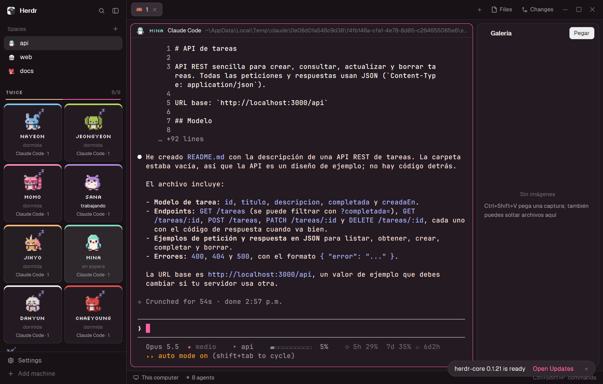

# herdr-twice

[Español](README.es.md)

A layout for [herdr](https://herdr.dev) where every coding agent gets a pixel TWICE mascot that shows its
status, plus an image gallery for Claude Code and a matching Claude Code status line.



- **twice-nine**: one mascot per agent (working, needs you, done, waiting, asleep). Free members sleep on
  the bench. `Alt+T` picks a member; the choice is remembered per space.
- **spaces-twice**: the spaces list, with each agent's mascot as avatar.
- **galeria**: `Ctrl+Shift+V` saves a screenshot as `@imagenN`; write `@imagen3` in Claude Code to use it.
- **nombre-agente**: unnamed spaces take their agent's title; `Ctrl+Shift+M` opens Claude in a folder.
- **statusline**: model, effort, branch, context and usage limits in one line.
- Themes `apricot-neon` (dark) and `apricot-cream` (light).

## Install

Requirements: herdr-app (open it once), Node and git.

**Easiest:** ask your agent in herdr: *"add herdr.dev/layouts/JhonZBM/twice"*. It follows herdr's own rules:
it copies without overwriting and asks before replacing a key you already use.

**With the script** (mods linked to the clone, so `git pull` updates them):

```sh
git clone https://github.com/JhonZBM/herdr-twice
cd herdr-twice
node instalar.js --galeria --statusline
```

Clone it wherever you like: nothing depends on its location. The script can be run again: it only adds
what's missing and warns (without overwriting) when something differs; `--forzar` overwrites.

- `--galeria` adds the `@imagenN` rule to `~/.claude/CLAUDE.md`.
- `--statusline` links `~/.claude/statusline` to the clone and sets `statusLine` in `~/.claude/settings.json`.

Restart herdr to load the pixel font. To update: `git pull`, then `node instalar.js` again (themes and
layout are copies).

## Keys

| Key | Action |
|---|---|
| `Ctrl+Shift+V` | Paste a screenshot or image into the gallery |
| `Alt+G` | Preview the last image (`←` `→` browse, `Enter` insert `@imagenN`, `Esc` close) |
| `Alt+T` | Pick a member for the focused agent |
| `Alt+Shift+T` | Next free member |
| `Ctrl+Shift+M` | Open a space with Claude in a folder |
| `Ctrl+Shift+L` | Switch layout (way out if `twice` fails) |

## Status line

```
Opus 5.5  ✦ medio    ▸ repo    main  ·  3 cambios    ⇡ 1    ▰▰▰▰▱▱▱▱▱▱  42%    ◷ 5h 30%  7d 65% ↻ 2d4h
```

Icons, colors, thresholds and spacing live in `statusline/iconos.json` (no code changes needed).

## Notes

- Paste in the gallery is Windows only (PowerShell); dropping files on it works everywhere.
- Mascots follow agents that report their status to herdr (Claude Code, Codex…). Cursor CLI doesn't.
- To see a change made to a mod: `herdr-app do layout.switch --name main`, then `--name twice`.
- Rebuild it from scratch: [RECIPE.md](RECIPE.md).

## Principle: lightweight

Zero dependencies (only Node and git), one file per piece, no build. herdr and Claude Code first. Light in
size and in resources too: no polling, few processes.

## License

Code: MIT. Silkscreen font: SIL OFL (`mods/twice-nine/fonts/OFL.txt`). The sprites are original pixel art,
an unofficial fan tribute; no logos or official images.
