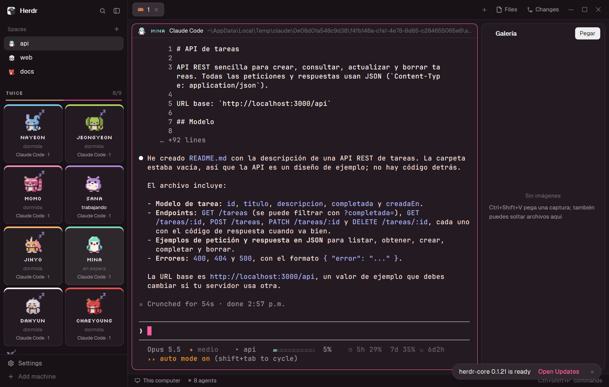

# TWICE

A herdr window where every coding agent gets a pixel mascot, one per TWICE member, that shows what the
agent is doing: working, needs you, done, waiting or asleep. The sidebar lists your spaces with each
agent's mascot as its avatar, and the rest of the members sleep on a bench underneath. A gallery on the
right keeps pasted screenshots as `@imagen1`, `@imagen2`… so you can refer to them from Claude Code.
Apricot and neon magenta, with a pixel font.

## What you see

Left to right:

- **Sidebar, 268 px.** `workspace-chrome` brand (46 px) on top. Below it, two lists that split the height:
  - **Spaces** (`spaces-twice`): one row per space. The avatar is that space's agent mascot (a still
    frame of its pose); with no mascot, the program's icon (Claude, Codex…); with no agent, the first
    letter on a colored tile. The name drops a leading `✻ ` and shows in full in the tooltip. The block
    is as tall as its rows (up to 8, then it scrolls) so the mascots get the rest.
  - **TWICE Nine** (`twice-nine`): a "photocard" per open agent (mascot, member name and color, status
    word, space name) and a bench with the members nobody uses, asleep with a "z z z".
  - `workspace-chrome` footer (69 px).
- **Work column.** `tabs` on top (42 px), the terminal in the middle, `workspace-status` at the bottom
  (28 px). Each pane header shows the agent's mini mascot next to its name.
- **Right column, 260 px**, next to the hidden Files/Changes stack:
  - **Gallery** (`galeria`) takes the height that's left: thumbnails labelled `@imagenN` with Paste and
    Clear buttons.
  - **The stage** (`twice-nine` with `props.escenario`), fixed at 330 px, not resizable: a drawn theatre
    (260×330) where each mascot stands where her status says. `Alt+R` hides or shows it.

Colors: apricot `#fcc89b`, magenta `#ff5fa2`, one color per member. Font: Silkscreen (OFL, shipped in
`mods/twice-nine/fonts/`). Themes `apricot-neon` (dark) and `apricot-cream` (light).

## How it behaves

- **Statuses**, two-frame animated SVG sprites per member and pose:
  - `working`: the mascot is busy; `blocked`: a "!" over it, "needs you"; `done`: sparkles, "done";
  - `idle`: awake and still while you're looking at that pane; idle and not focused: it falls asleep;
  - members with no agent sleep on the bench, nodding with "z z z".
- **Mother and child:** a session launched from another one (`hc run`; herdr records its `parent`) gets a
  card right after its mother's, even without a pane of its own. While the child works or needs you, the
  mother shows `wait` (still, with a pulsing hourglass): "esperando a" and the child's mini mascot. The
  child says "trabajando con" her mother, or its status and "↳ mother". Clicking either line goes to the
  other one. Priority: blocked > wait > the agent's own status.
- **Backing singers:** each open Claude Code subagent wakes a free member from the bench, drawn small and
  working on the leader's card (tooltip: the subagent type). Up to 4 per card; the rest count as "+n".
- **The stage:** surtitles on top with the most urgent thing in one line (needs you > done > waiting);
  wings on the left for `wait`, dressing room on the right for idle and asleep; `working` strolls on the
  boards; `blocked` stands bigger at the microphone, bouncing under the only spotlight; `done` at the
  corners; free members sit in the front row. Singers stand behind their leader. Moving between zones is
  animated; click a mascot to go to her agent, hover for her task.
- **Picking a member:** `Alt+T` opens a centered dialog for the focused agent; clicking the header mascot
  opens the same picker by the pointer; right-click on a sidebar card picks for that agent. Click or
  arrows + Enter; Esc or a click outside closes. Each card says if the member is free or which space has
  her; taking a busy one swaps them. The choice is remembered per space, so the next agent opened there
  gets the same member. `Alt+Shift+T` moves to the next free member without opening anything.
- **Gallery:** `Ctrl+Shift+V` saves the clipboard image as `imagenN.png` (also an image file you copied);
  you can also drop files on the panel. Click a thumbnail for a large preview (`←` `→` to browse,
  `Enter` inserts `@imagenN`, `Esc` closes); `Alt+G` opens the last one. "@ insert" types `@imagenN ` into
  the focused terminal. Clear empties the gallery and numbering starts again at 1.
- **Agent names:** an unnamed space called `~` takes its agent's session title, prefixed with `✻`.
  `Ctrl+Shift+M` picks a folder and opens a space with Claude there.

## Built from

- Layout `layouts/twice.json`, cloned from the shipped `main` (0.1.15): the `agents` block is kept but
  hidden (its order is replaced by `twice-nine`'s `setAgentOrder`); `twice-nine` is also the `header`
  of the pane template; `nombre-agente` is a 0 px block (no UI, only logic); the gallery and the stage
  share a `derecha` column, and `alt-r` is just `layout.toggle:escenario` (no code).
- `mods/twice-nine/`: `main.js` (sidebar, header, picker overlay and stage in one mod, chosen by
  `props()`), `escenario.js` (the stage), `relaciones.js` (who launched whom and who has subagents, read
  from `terminals()`: `parent` and the `twice.sub.*` labels), `members.js` (names, colors, labels),
  `sprites/` (90 member SVGs + `bang`, `sparkle`, `zzz`, `wait`, `escena`, `foco`), `fonts/`. State in
  `shared("twice.slots")` and `shared("twice.prefs")`. Uses `agents`, `terminals`, `panes`, `spaces`,
  `setAgentOrder`, `openOverlay`, `nextCommand`; runs no programs and no timers.
- `subagentes/subagente.js`: a Claude Code hook. `SubagentStart` runs `hc label <terminal>
  twice.sub.<agent_id>=<agent_type>`, `SubagentStop` clears it; `SessionStart`, `SessionEnd` and a `Stop`
  with no background tasks sweep whatever is left. Does nothing outside herdr (no `HC_TERMINAL_ID`),
  always exits 0, and is installed `async` so it never holds Claude back.
- `demo/agente-falso.js`: a fake agent that reports its status with OSC 7501 and obeys single keys
  (`w` `b` `d` `i`, `h` child, `s`/`S` subagent label, `q`). For testing and for retaking `preview.png`.
- `demo/presentacion.js`: a scripted tour over fake agents (`herdr-app do` and `hc` only, one call per step) to record
  a demo or retake `preview.png` without spending a real agent.
- `mods/spaces-twice/`: clone of the shipped `spaces` (0.1.15) with the avatar, name and height changes
  above; runs `git` (as `spaces` does) and `layout.resize` on its own block.
- `mods/galeria/`: images in `~/.config/herdr-app/galeria/`; runs PowerShell to read the clipboard and to
  paste `@imagenN` (the clipboard is the only way to type `@`); copying dropped files also goes through
  PowerShell (the mod `fs` writes 0 bytes for binary data).
- `mods/nombre-agente/`: `space.rename` from the agent's title; `pickFolder` + `space.new`.
- Keys: each mod's `keys.json` (`mods/<mod>/keys.json`), merged into the global section. Also remove `"ctrl-shift-v": "terminal.paste"` from the
  `terminal` section, or that key keeps pasting text instead of the screenshot.

## Watch out

- The layout names its themes: copy `themes/*.json` too, or herdr rejects the whole layout
  (`herdr-app status` → `errors`).
- The pixel font loads when herdr restarts.
- Paste in the gallery is Windows only (PowerShell); dropping files works everywhere.
- Claude Code doesn't know `@imagenN` on its own: add this line to `~/.claude/CLAUDE.md`: "If the user
  mentions `@imagenN`, read `~/.config/herdr-app/galeria/imagenN.png` with Read". `instalar.js --galeria`
  does it.
- Mascots only follow agents that report a status to herdr (OSC 7501: `ESC ] 7501 ; state=working:app=cursor ESC `).
  Claude Code does it itself. Cursor CLI and Codex don't, and their hooks run without the terminal, so writing the
  sequence from a hook never reaches it: `agentes/lanzador.js <cursor|codex>` launches the CLI, listens on a local pipe
  and writes the sequence itself; `agentes/estado.js <state>`, called from the hooks, sends the state there.
  - Cursor (`~/.cursor/hooks.json`): `sessionStart`/`stop` → idle, `beforeSubmitPrompt` → working. No hook fires on
    permission prompts, so Cursor never shows "needs you".
  - Codex (`~/.codex/hooks.json`): `SessionStart`/`Stop`/`Interrupt` → idle, `UserPromptSubmit` → working,
    `PermissionRequest` → blocked, `PostToolUse` → working (back from "needs you" once you answer). Launched with
    `--no-daemon`. New hooks don't run until reviewed with `/hooks` inside Codex.
  - The hook always answers JSON (`{}`, or `{"continue":true}` on a prompt): Codex takes plain text as model context.
  - The `+` menu entry is herdr's own `cursor` / `codex` with only `run` overridden in `programs.json` (the launcher);
    the installer removes the older separate `cursor-twice` / `codex-twice` entries.
  - Tried and dropped: on Windows, Cursor runs hooks in a hidden console of their own, so even writing the sequence to
    `CONOUT$` from the hook doesn't reach the terminal.
  - `cursor/cursor-twice.js` and `cursor/estado.js` are the old paths, kept as redirects.
- A subagent interrupted with Esc, or a killed process, may never fire `SubagentStop`: that is what the
  sweep is for. Until the session next stops or starts, its singer stays.
- A child launched with `hc run --bg` has no pane, so it isn't in `agents()`: take it from `terminals()`.
- The fake agent takes keys with `hc keys <t> w`, not `hc send` (it ignores anything longer than one key).
- herdr doesn't notice edits made through a junction: to see a change in a mod, switch to `main` and back.
- Since herdr 0.1.16, `image()` and `svg()` only draw files that really live under `~/.config/herdr-app`: not
  through a junction, not by an absolute path outside it. `instalar.js` copies each mod's `.svg` files to
  `herdr-twice/<mod>/` and the mods use that copy when it exists (`ARTE` in `twice-nine/members.js`, the same
  check in `spaces-twice` and `galeria`); a mod copied by hand keeps using its own folder. After changing a
  sprite, run `node instalar.js` again.
- `herdr-app check` doesn't run async code: a failure inside `cx.spawn` passes the check.
- Sprites are original pixel art; no logos or official images.

## Done when

- `herdr-app check` passes for the four mods and `herdr-app status` shows `"layout": "twice"` and no errors.
- Opening Claude in a space gives it a mascot card; while it works the mascot animates, a permission
  prompt shows "needs you", and switching to another pane makes an idle one fall asleep.
- `Alt+T` swaps the member, and the next Claude opened in that space gets the same one.
- With two fake agents, mother and child (`h`, then `w` on the child): the mother says "esperando a" and
  the child "trabajando con"; `i` on the child puts the mother back.
- `s` on a fake agent adds a singer to its card and `S` removes it; a real Explore from Claude does the same.
- `Alt+R` hides and shows the stage; each status sends the mascot to its zone.
- The spaces list shows the mascot as avatar and is only as tall as its rows.
- `Ctrl+Shift+V` with a screenshot copied adds `@imagen1`; "@ insert" types it in the prompt.
