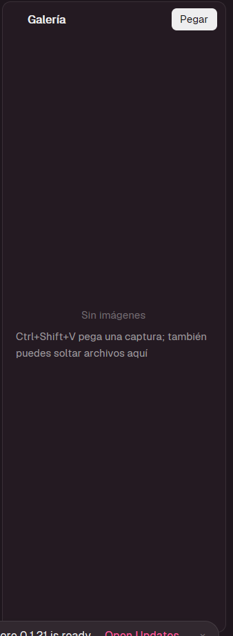

# Galería

A side panel that keeps pasted screenshots as `@imagen1`, `@imagen2`… so you can refer to them from
Claude Code by name, in any prompt, without pasting again. Part of the [twice](../../RECIPE.md) layout,
but it works in any layout.

## What you see

A panel (260 px in twice) titled "Galería" with **Pegar** (paste) and **Limpiar** (clear) buttons and a
column of thumbnails, each labelled `@imagenN` with an "@ insertar" button. Empty, it explains how to add
images.

## How it behaves

- `Ctrl+Shift+V` (or Pegar) saves the clipboard image as `imagenN.png`; also an image file you copied.
  Dropping files on the panel copies them in. If the block is hidden, pasting shows it.
- Click a thumbnail: large preview (`←` `→` browse, `Enter` inserts `@imagenN`, `Esc` closes). `Alt+G`
  opens the last one. "@ insertar" types `@imagenN ` into the focused terminal.
- The small **×** over a thumbnail deletes just that image (and its display copy) from the folder, with
  no confirmation and without touching the other numbers.
- Limpiar asks first, empties the gallery and numbering starts again at 1.

## Built from

- Images in `~/.config/herdr-app/galeria/` (`appHome()`: `image()` only reads inside the app's folder).
- Runs PowerShell (`exec`) to read the clipboard, to type `@imagenN` through the clipboard (the only way to
  type `@`) and to copy dropped files (the mod `fs` writes 0 bytes for binary data). Nothing runs while it
  just draws.
- Uses `layout.show` on the block with id `galeria`, the shipped `confirm` mod, `nextCommand` for
  `galeria.pegar` and `galeria.ver`.

## Add it to a layout

- A block with id `galeria`: `{ "id": "galeria", "type": "block", "size": { "px": 260 }, "content": { "mod": "galeria" } }`
  (to the right of the tab block in twice).
- Keys: merge `keys.json` (`ctrl-shift-v`, `alt-g`) and remove `"ctrl-shift-v": "terminal.paste"` from the
  `terminal` section, or that key keeps pasting text.
- For Claude Code to read `@imagenN`, add to `~/.claude/CLAUDE.md`: "If the user mentions `@imagenN`, read
  `~/.config/herdr-app/galeria/imagenN.png` with Read" (`instalar.js --galeria` does it).

## Watch out

- Pasting is Windows only (PowerShell); dropping files works everywhere.
- Claude Code's `@` menu doesn't suggest gallery images: type `@imagenN` or use "@ insertar".
- herdr caches images by path: after Limpiar, thumbnails are shown from uniquely named copies in
  `galeria/vista/`.

## Done when

- `herdr-app check` passes; with a screenshot copied, `Ctrl+Shift+V` adds `@imagen1`.
- "@ insertar" types it in the prompt and Claude Code describes the image.
