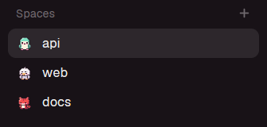

# Spaces (TWICE)

herdr's spaces list where each space's avatar is its agent's TWICE mascot, the name shows clean and in
full, and the block is only as tall as its rows. Part of the [twice](../../RECIPE.md) layout.

## What you see

The shipped `spaces` list (grouped by machine, worktrees under their repo, branch and ahead/behind only
when unusual) with three changes:

- Avatar (18 px): the space's agent mascot from twice-nine (a still frame of its pose); with no mascot,
  the program's icon (Claude, Codex…); with no agent, the first letter on a colored tile.
- Name without a leading `✻ ` (nombre-agente's mark), never cut at 150 px; the full name in the tooltip.
- Height: as tall as its rows, up to 8, then it scrolls.

## How it behaves

Same as `spaces`: click to switch, right-click for the menu, drag to reorder. The avatar follows the
mascot's pose as the agent works.

## Built from

- A clone of the shipped `spaces` (herdr 0.1.15, `mod.clone`), changing avatar, name and height only.
- Reads `shared("twice.slots")`, written by twice-nine (the nine member slugs are copied in: a mod can't
  import another's code). Runs `git` and `hc machine ls` like `spaces` does.
- Resizes its own block with `layout.resize` when the number of rows changes (only then).

## Add it to a layout

Replace `spaces` with it: `{ "id": "spaces", "type": "block", "content": { "mod": "spaces-twice" } }`. The
block id must be `spaces` (the auto height looks for it) and the sidebar column `sidebar` (narrow rail).

## Watch out

- Without twice-nine there are no mascots: it looks like `spaces` with program icons.
- A clone doesn't get herdr's updates to `spaces`.

## Done when

- `herdr-app check` passes; with twice-nine, each space with an agent shows its mascot as avatar.
- Opening or closing a space resizes the block to its rows.
