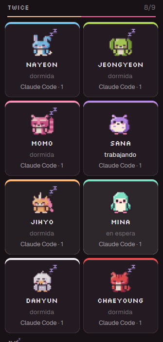

# TWICE Nine

Every coding agent gets a pixel mascot, one per TWICE member, that shows what it's doing. The sidebar
shows a card per agent and a bench where the members nobody uses sleep; each pane header shows the
agent's mini mascot. Part of the [twice](../../RECIPE.md) layout, but it works in any layout.

## What you see

- **Sidebar block** (fills its space; ~268 px wide in twice): a "TWICE n/9" title with an apricot→magenta
  line, then two columns of cards (mascot 48 px, member name in Silkscreen, status word, "program · tab"),
  each with a top stripe in the member's color. Below, the bench: the free members, small and asleep.
- **Pane header**: the mini mascot (14 px) and the member name next to the program and folder.
- **Picker**: a dialog with the nine members, each card saying if she's free or which space has her.

Colors: apricot `#fcc89b`, magenta `#ff5fa2`, one color per member (`members.js`). Font: Silkscreen (OFL,
in `fonts/`).

## How it behaves

- `working`: busy animation; `blocked`: a "!" ("needs you"); `done`: sparkles; `idle`: awake while you
  look at that pane, asleep ("z z z") when you don't. Free members sleep on the bench.
- `Alt+T` picks a member for the focused agent (centered dialog); click on the header mascot opens it by
  the pointer; right-click on a card picks for that agent. Click or arrows + Enter; Esc closes. Taking a
  busy member swaps them. The choice is remembered per space. `Alt+Shift+T`: next free member.
- Only agents that report a status to herdr get a mascot (Claude Code, Codex…; Cursor CLI through the
  repo's `cursor/` launcher).

## Built from

- One mod, three roles by `props()`: sidebar block (no props), pane header (`props().pane`), picker
  overlay (`props().elegir`, opened with `openOverlay`).
- Uses `agents`, `panes`, `spaces`, `setAgentOrder`, `openOverlay`, `nextCommand`, `shared("twice.slots")`
  and `shared("twice.prefs")`. Runs no programs, no timers: the sprites animate with native loops.
- Art: `sprites/<member>-<state>-<a|b>.svg` (two frames per pose) plus `bang`, `sparkle`, `zzz`.

## Add it to a layout

- A block in the sidebar: `{ "id": "twice-nine", "type": "block", "content": { "mod": "twice-nine" } }`.
- Optional, the header of the tab block's panes: `"pane": { "header": { "content": { "mod": "twice-nine" }, "height": 30 } }`.
- Keys: merge `keys.json` (`alt-t`, `alt-shift-t`).

## Watch out

- The pixel font loads when herdr restarts.
- `mod.json` has `"place": "none"`: it only shows where a layout puts it.
- Sprites are original pixel art; no logos or official images.

## Done when

- `herdr-app check` passes; opening Claude gives it a card that animates while it works.
- `Alt+T` swaps the member and the next Claude in that space gets the same one.
